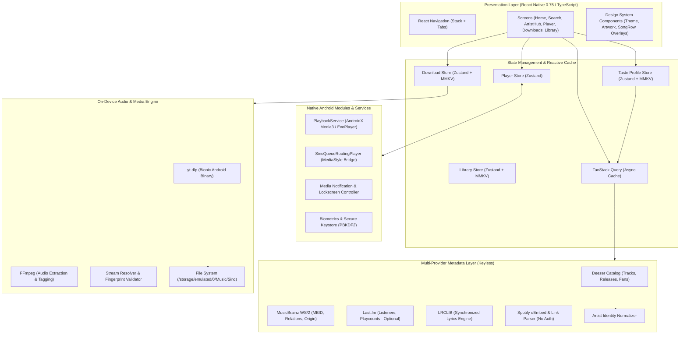

<p align="center">
  
</p>

<h1 align="center">Sinc</h1>

<p align="center">
  <strong>Your music. Your library. Zero compromises.</strong><br>
  A high-fidelity, local-first Android music client built around discovery, true file ownership, synchronized lyrics, and on-device intelligence without cloud tracking.
</p>

<p align="center">
  <a href="https://github.com/fax-solo/Sinc/releases/latest"></a>
  <a href="#architecture"></a>
  <a href="#developer-guide"></a>
  <a href="#developer-guide"></a>
  <a href="#developer-guide"></a>
  <a href="#privacy--security"></a>
</p>

<p align="center">
  <a href="#-project-overview">Overview</a> •
  <a href="#-interface-preview">Preview</a> •
  <a href="#-key-features">Key Features</a> •
  <a href="#-architecture--tech-stack">Architecture</a> •
  <a href="#-how-sinc-works">How It Works</a> •
  <a href="#-installation">Installation</a> •
  <a href="#-developer-guide">Developer Guide</a> •
  <a href="#-roadmap">Roadmap</a> •
  <a href="#-contributing">Contributing</a>
</p>

---

## 📖 Project Overview

Modern music streaming has quietly transformed music lovers from **owners** into **renters**. Songs disappear when regional licenses expire, music is locked inside encrypted proprietary caches unreadable by other apps, algorithms push paid promotional tracks, and every listen is logged, tracked, and monetized on distant servers.

**Sinc is built on a different principle:**

> _When you discover music you love, you should actually own it. Play any track, sing along with synchronized lyrics, learn its context, and keep it on your phone as a standard, universally accessible audio file._

### Core Philosophies

- 📂 **True File Ownership**: Songs aren't hidden in a proprietary vault. Sinc exports real, standard `.m4a` / `.mp3` files into your device's public `Music/Sinc/` directory, complete with embedded ID3v2.4 / MP4 metadata and high-resolution cover artwork. Play them in Samsung Music, VLC, Poweramp, or transfer them to any device.
- 🚫 **Zero Accounts & Zero Subscriptions**: No login walls, no subscription fees, no credit cards, and no tracking cookies.
- 🔑 **Keyless Open-Source Metadata**: Powered by legitimate open metadata providers (Deezer Public API, MusicBrainz WS/2, LRCLIB) without requiring Spotify API developer credentials or client secrets.
- 🧠 **On-Device Intelligence**: A local-first taste engine that learns your preferences, balances repetition with discovery, and suggests fresh music—running 100% on your hardware with a complete privacy reset switch.
- ⚡ **Native Audio Excellence**: Powered by AndroidX Media3 (ExoPlayer), with full background audio playback, system lock screen controls, and responsive seeker physics.

---

## 📱 Interface Preview

Sinc is crafted with a quiet, refined dark-charcoal foundation (`#0B0F0E`), emerald accents (`#1ED760`), and smooth micro-interactions:

|                                                     🎵 Home & Discovery                                                      |                                                   🌟 Artist Hub & Discography                                                    |                                                 ▶️ Player & Synced Lyrics                                                  |
| :--------------------------------------------------------------------------------------------------------------------------: | :------------------------------------------------------------------------------------------------------------------------------: | :------------------------------------------------------------------------------------------------------------------------: |
| <br><sub>_Daily Picks, Made for You, Weekly Discovery Mix_</sub> | <br><sub>_Verified badges, segmented releases, similar artists_</sub> | <br><sub>_Live seeking, output routing, LRCLIB lyrics_</sub> |

|                                                    🔍 Search & Spotify Import                                                     |                                                      📥 Downloads & Library                                                      |                                                     🔒 Security & App Lock                                                      |
| :-------------------------------------------------------------------------------------------------------------------------------: | :------------------------------------------------------------------------------------------------------------------------------: | :-----------------------------------------------------------------------------------------------------------------------------: |
| <br><sub>_Instant multi-provider search & Spotify URL import_</sub> | <br><sub>_Concurrent queue, progress bars, retry manager_</sub> | <br><sub>_Biometric fingerprint lock + PBKDF2 PIN safety_</sub> |

> [!TIP]
> **Capturing Screenshots for Documentation**:
> Maintainers and contributors can update this gallery with live captures directly from a connected device or emulator:
>
> ```bash
> adb exec-out screencap -p > docs/screenshots/home.png
> ```

---

## ✨ Key Features

### 🎧 High-Performance Audio Engine & Playback

- **AndroidX Media3 (ExoPlayer)**: Native audio playback engine providing rock-solid stability, low latency, and efficient hardware decoding.
- **Custom Queue Routing**: Implements `SincQueueRoutingPlayer` to bridge Android `MediaStyle` notification actions (Previous, Play/Pause, Next) with the React Native queue store.
- **System Lock Screen Integration**: Rich lockscreen media controls with artwork display, live progress tracking, and custom session actions (Favorite toggle & Show Lyrics shortcut).
- **Audio Becoming Noisy**: Automatically pauses playback when headphones or Bluetooth devices disconnect.
- **Full Queue Management**: Reorder upcoming tracks, toggle shuffle modes, loop single songs or entire playlists, and switch audio output devices.

---

### 🌟 Comprehensive Artist Hub & Music Discovery

- **Provider-Independent Architecture**: Combines **Deezer Public API**, **MusicBrainz WS/2**, and **LRCLIB** into a normalized artist graph.
- **Verified Artist Profiles**: Hero artwork, verified badges, Deezer fan counts, MusicBrainz origin and formation years, and Last.fm listener metrics.
- **Categorized Discography**: Cleanly segmented into **Albums**, **Singles & EPs**, and **Compilations** with release dates and total track counts.
- **Popular Tracks & Playlists**: Instant access to an artist's top-streamed songs and curated playlists.
- **Similar Artists Carousel**: Explore related musical acts with intuitive lateral navigation.
- **External Web Links**: Direct cross-links to Spotify, Deezer, MusicBrainz, and official artist websites.

---

### 🧠 Local-First Music Intelligence & Taste Profile

- **On-Device Scoring**: Automatically computes artist and genre affinities from playback history without sending any data off-device.
- **Dual-Decay Memory**: Blends short-term listening trends ($\tau = 5$ days) with long-term musical taste ($\tau = 30$ days).
- **Rule 13 Skip Safety**: Tracks skipped within the first 30 seconds are down-weighted ($w = 0.15$) rather than treated as active dislikes, preventing accidental skips or mood changes from corrupting recommendations.
- **Maximal Marginal Relevance (MMR)**: Tunable diversity re-ranking ($\lambda = 0.70$) that balances familiar favorites with fresh discoveries, preventing artist monopolization.
- **Discovery Temperature Modes**: Choose between _Familiar_ ($T = 0.2$), _Balanced_ ($T = 0.7$), and _Exploration_ ($T = 1.4$) to shape your daily mixes.
- **Privacy Kill-Switch**: Reset all personalization data or disable recommendation learning in one tap.

---

### 📥 True Downloads & Universal File Ownership

- **Direct Device Storage**: Downloads save directly to `Music/Sinc/` in standard device storage—not an encrypted app-specific sandbox.
- **Standard Audio Formats**: Saved as pristine `.m4a` (AAC) or `.mp3` containers.
- **Embedded ID3v2.4 & MP4 Tags**: Automatically bakes Title, Artist, Album, Release Year, Track Number, and High-Resolution Cover Art into the audio file itself.
- **Anti-Garbage Stream Verification**: Rejects live bootlegs, nightcore edits, slowed+reverb modifications, and tracks with significant duration drift ($>15$s).
- **Concurrent Download Queue**: Live percentage progress indicators, background download notifications, pause/resume, and automated retry management for interrupted transfers.

---

### 🟢 Zero-Credential Spotify Playlist Importer

- **Paste & Ingest**: Paste any public Spotify playlist, album, or track URL (`https://open.spotify.com/playlist/...`).
- **Zero API Keys**: Uses public oEmbed and open web parsers—no Spotify Developer account, Client ID, or Client Secret required.
- **Batch Resolution**: Resolves track lists and automatically routes songs into Sinc's download queue or active playback queue.

---

### 🎤 Synchronized Real-Time Lyrics

- **Millisecond Precision**: Powered by the open LRCLIB database, automatically scrolling line-by-line as the song plays.
- **Interactive Line Seeking**: Tap any lyric line in the full-screen view to seek directly to that exact moment in the track.
- **Linguistic Normalization (Arabic & Multi-Lingual)**: Normalizes Arabic character variants (Alef `أ/إ/آ` $\to$ `ا`, Yeh `ى` $\to$ `ي`, Teh Marbuta `ة` $\to$ `ه`) and strips diacritics (tashkeel) so Arabic and Middle Eastern tracks match lyrics reliably.
- **Plain Text Fallback**: Displays static lyrics whenever synchronized time stamps are not available.

---

### 🔒 Privacy, Security & Customization

- **Hardware-Backed App Lock**: Protect your music library with Android Biometric Authentication (Fingerprint / Face Unlock).
- **Cryptographic PIN Protection**: Hardware-backed PIN fallback hashed using **PBKDF2** (10,000 iterations, 32-byte per-device salt) stored securely via React Native Keychain.
- **Local MMKV Storage**: High-speed, memory-mapped key-value storage keeps your data fast, private, and offline.
- **Personalized Theme Engine**: Switch between Dark, Light, and System themes, with six accent color palettes (Emerald, Sky, Indigo, Rose, Amber, Gold).

---

## 🏗 Architecture & Tech Stack

Sinc is architected as a modern, reactive TypeScript monorepo powered by React Native and native Android services:



### Technology Highlights

| Layer               | Technologies                                 | Role                                                                   |
| ------------------- | -------------------------------------------- | ---------------------------------------------------------------------- |
| **Mobile Client**   | React Native 0.75.5, TypeScript 5.7          | Cross-platform core and reactive user interface                        |
| **State & Cache**   | Zustand 5, TanStack Query 5                  | Client state, download queues, and asynchronous caching                |
| **Native Playback** | Kotlin 1.9, AndroidX Media3 (ExoPlayer 1.4)  | Background audio playback, lock screen controls, and audio routing     |
| **Local Storage**   | react-native-mmkv, react-native-keychain     | Fast key-value persistence, biometric security, and PBKDF2 PIN hashing |
| **Media Engine**    | yt-dlp, FFmpeg 6.0 (Android bionic binaries) | On-device audio stream resolution, conversion, and ID3 tag baking      |
| **Metadata**        | Deezer Public API, MusicBrainz WS/2, LRCLIB  | Keyless, unified music catalog, discography, and synced lyrics         |
| **Shared Package**  | `@sinc/shared` (TypeScript + Zod 3.24)       | Shared domain contracts, validation schemas, and entity models         |

> Detailed technical specifications can be found in [`docs/ARCHITECTURE.md`](docs/ARCHITECTURE.md) and [`docs/PROVIDERS.md`](docs/PROVIDERS.md).

---

## 🔄 How Sinc Works

Sinc separates **catalog metadata** from **audio stream resolution**:

```
1. Search / Ingest          2. Canonical Metadata           3. Stream Resolution
   User query or Spotify       Query Deezer & MusicBrainz      Resolve audio stream candidate
   playlist URL                Assemble Title, Artist,         Match duration (±15s) and
                               Album, Cover Art, ISRC          tokens to reject edits/live tracks
                                        │                                   │
                                        ▼                                   ▼
                              ┌──────────────────┐               ┌──────────────────┐
                              │ Sinc Metadata    │               │ Verified Audio   │
                              │ Entity Model     │               │ Source Stream    │
                              └─────────┬────────┘               └─────────┬────────┘
                                        │                                   │
                                        └─────────────────┬─────────────────┘
                                                          │
                                         ┌────────────────┴────────────────┐
                                         ▼                                 ▼
                                  [ Playback ]                      [ Download ]
                                 ExoPlayer streams               FFmpeg extracts audio,
                                 in background with              embeds ID3 metadata, and
                                 synced LRCLIB lyrics            writes to Music/Sinc/*.m4a
```

1. **Metadata Assembly**: Sinc queries Deezer and MusicBrainz to fetch accurate artist names, track titles, album details, release years, and uncompressed cover art.
2. **Audio Stream Resolution**: Sinc locates matching candidate audio streams using its on-device resolver.
3. **Acoustic Fingerprint Validation**: Sinc verifies the candidate stream:
   - Duration must match within $\pm 15$ seconds.
   - Title must match without containing unwanted tokens (`live`, `slowed`, `reverb`, `nightcore`, `instrumental`, `cover`).
4. **Playback or Download**:
   - **Playback**: Streamed immediately through ExoPlayer with background notification controls.
   - **Download**: Converted by on-device FFmpeg, embedded with full ID3 tags, and saved to public storage.

---

## 📥 Installation

### For Android Users (Recommended)

1. Navigate to the [**Latest Sinc Release**](https://github.com/fax-solo/Sinc/releases/latest).
2. Download the `sinc-0.3.0-*.apk` file.
3. Open the downloaded APK on your Android device. If prompted, grant permission to install apps from your browser or file manager.
4. Launch **Sinc** and enjoy your music!

**System Requirements:**

- Android 8.0 (API Level 26) or higher.
- Recommended: 64-bit ARM device (`arm64-v8a`) manufactured from 2017 onward.

#### Keeping Sinc Updated

Sinc includes an integrated release checker. Open **Library → Settings → About & Updates** to check for newer versions and download updates directly—no Google Play Store required.

---

## 🛠 Developer Guide

### Prerequisites

Ensure you have the following installed on your development workstation:

- **Node.js**: `v20.x` or later (LTS recommended)
- **npm**: `v10.x` or later
- **JDK**: Java Development Kit 17 (Azul Zulu 17 or OpenJDK 17)
- **Android SDK**: Platform 34 (API 34), Build-Tools 34.0.0, NDK 26.1.10909125
- **Python**: Python 3.10+ (for building bundled media binaries)

### 1. Clone & Install Dependencies

```bash
# Clone the repository
git clone https://github.com/fax-solo/Sinc.git
cd Sinc

# Install workspace dependencies
npm ci

# Build the shared TypeScript library
npm run build -w @sinc/shared
```

### 2. Build Mobile Media Binaries

The on-device media engine requires native Android binaries (`yt-dlp` and `ffmpeg`) compiled for Android bionic. These are compiled using our automated build script:

```bash
bash scripts/build-mobile-media-binaries.sh
```

### 3. Run Development Build

```bash
# Start Metro bundler and deploy to a connected Android device or emulator
npm run android
```

### 4. Running Verification & Tests

Sinc maintains a comprehensive test suite across unit, integration, and UI component layers:

```bash
# Run all unit and integration tests across workspaces
npm test

# Run TypeScript typechecks across workspaces
npm run typecheck

# Check code formatting with Prettier
npm run format:check

# Run ESLint analysis
npm run lint
```

### 5. Assembling a Production APK

To assemble a release APK locally:

```bash
cd apps/mobile/android
./gradlew assembleRelease
```

The output APK will be generated under `apps/mobile/android/app/build/outputs/apk/release/`.

---

## ⚙️ Configuration & Environment

Sinc is designed to work completely out-of-the-box without required environment files. However, optional services can be configured:

| Setting / Variable    | Location                                         | Default       | Purpose                                                                  |
| --------------------- | ------------------------------------------------ | ------------- | ------------------------------------------------------------------------ |
| `APP_VERSION`         | `apps/mobile/src/services/updates/appUpdates.ts` | `0.3.0`       | Application release version used by update checker and CI release tagger |
| `DEFAULT_TEMPERATURE` | `apps/mobile/src/services/local/tasteProfile.ts` | `0.7`         | Discovery temperature balancing familiar and new music                   |
| `DOWNLOAD_DIR`        | Android Storage                                  | `Music/Sinc/` | Destination folder for exported `.m4a` and `.mp3` files                  |
| `LASTFM_API_KEY`      | Optional / Local Settings                        | `""`          | Optional API key to fetch extended Last.fm global playcounts             |

---

## 📁 Project Structure

```
Sinc/
├── apps/
│   ├── mobile/                      # React Native Android Application
│   │   ├── android/                 # Native Android project (Kotlin, Media3, ExoPlayer)
│   │   │   └── app/src/main/java/   # Custom native modules (PlaybackService, PlayerModule)
│   │   └── src/
│   │       ├── app/                 # App root and navigation setup
│   │       ├── features/            # Feature modules (profile, settings, updates)
│   │       ├── services/
│   │       │   ├── local/           # Taste profile, taste intelligence, MMKV persistence
│   │       │   ├── native/          # Native bridge bindings and state listeners
│   │       │   ├── player/          # PlayerService, queue management, transport controls
│   │       │   └── providers/       # Deezer, MusicBrainz, Last.fm, Spotify, LRCLIB
│   │       └── ui/
│   │           ├── components/      # Atomic UI components, artwork, cards, song rows
│   │           ├── navigation/      # Stack & bottom tab navigator definitions
│   │           ├── screens/         # Screens (HomeScreen, ArtistHubScreen, PlayerScreen, etc.)
│   │           └── theme.ts         # Visual tokens, colors, typography, and spacing
│   └── server/                      # Optional Fastify + Prisma backend (self-hosted companion)
├── packages/
│   └── shared/                      # Shared TypeScript models, contracts, and Zod schemas
├── scripts/                         # Build scripts for media engine and release keystores
├── docs/                            # Deep-dive architecture and milestone documentation
│   ├── ARCHITECTURE.md              # System design and data flow specification
│   ├── PROVIDERS.md                 # Metadata provider architecture & rate-limiting
│   ├── PROGRESS.md                  # Milestone progress and native media implementation
│   ├── RELEASING.md                 # Maintainer guide for cutting signed GitHub releases
│   └── DOWNLOAD_QA.md               # QA test matrices and audio verification criteria
├── CONTRIBUTING.md                  # Contributor guide and pull request process
├── App icon.png                     # Official Sinc application brand icon
└── package.json                     # Monorepo workspaces and script orchestration
```

---

## 🗺 Roadmap

- [x] **v0.1.0 — Core Foundation**: ExoPlayer audio playback, search interface, and basic local library.
- [x] **v0.2.0 — Enhanced Playback & Downloads**: MediaStyle notification controls, on-device FFmpeg extraction, and LRCLIB synced lyrics.
- [x] **v0.3.0 — Artist Hub & Personalization Intelligence**:
  - Keyless multi-provider Artist Hub (Deezer + MusicBrainz + Last.fm).
  - Categorized discography (Albums, EPs, Compilations) and similar artists graph.
  - Local-first taste engine with exponential decay and Rule 13 skip safety.
  - Spotify playlist URL ingestion without developer credentials.
  - Biometric authentication and PBKDF2 cryptographic PIN protection.
- [ ] **v0.4.0 (In Progress)**:
  - Last.fm and ListenBrainz background scrobbling.
  - Offline lyrics caching.
  - Equalizer and custom audio presets.
- [ ] **Future Horizons**:
  - Direct local WiFi device-to-device library synchronization.
  - Lossless FLAC stream negotiation when available.
  - Desktop companion application.

---

## ⚠️ Known Limitations & Boundaries

To remain transparent with our users and developers:

- **Streaming DRM**: Sinc does not decrypt or circumvent Widevine or proprietary DRM-protected streams. All resolved audio is acquired from legitimate open sources.
- **MusicBrainz Rate Limiting**: The public MusicBrainz API enforces a 1 request/second rate limit. Sinc implements strict client-side throttling to respect their infrastructure; initial discography enrichment may take a brief moment.
- **Battery Optimization**: On certain aggressive Android OEM skins (e.g., Xiaomi MIUI, Samsung OneUI), background downloads may pause if the app is killed by the OS. We recommend whitelisting Sinc under **App Info → Battery → Unrestricted** for large playlist downloads.

---

## 🤝 Contributing

We love contributions! Whether fixing bugs, improving translations, adding features, or refining documentation, please check out our [**Contributing Guide**](CONTRIBUTING.md) to get started.

Please adhere to our core principles: keep it local-first, preserve zero-account privacy, ensure tests pass, and treat audio files as owned by the user.

---

## ⚖️ License & Acknowledgements

### Responsibility & Copyright

Sinc is free, open-source software designed for personal music listening, discovery, and archiving. Please respect copyright laws and intellectual property rights in your jurisdiction. Do not use Sinc to redistribute copyrighted media.

### Upstream Open-Source Projects

Sinc stands on the shoulders of remarkable open-source engineering:

- [React Native](https://reactnative.dev/) — Mobile application framework
- [AndroidX Media3 ExoPlayer](https://developer.android.com/media/media3/exoplayer) — Native Android media engine
- [yt-dlp](https://github.com/yt-dlp/yt-dlp) & [FFmpeg](https://ffmpeg.org/) — Audio resolution, extraction, and container tagging
- [MusicBrainz](https://musicbrainz.org/) & [Deezer](https://developers.deezer.com/) — Rich, open music metadata
- [LRCLIB](https://lrclib.net/) — Open, community-driven synchronized lyrics database
- [Zustand](https://github.com/pmndrs/zustand) & [TanStack Query](https://tanstack.com/query) — State management and asynchronous data caching

---

<p align="center">
  <strong>Sinc</strong> — Built with passion for the love of music 💛
</p>
