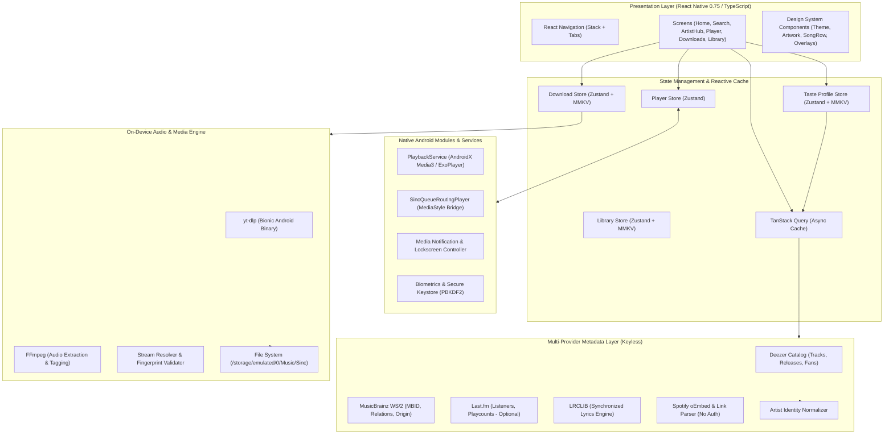
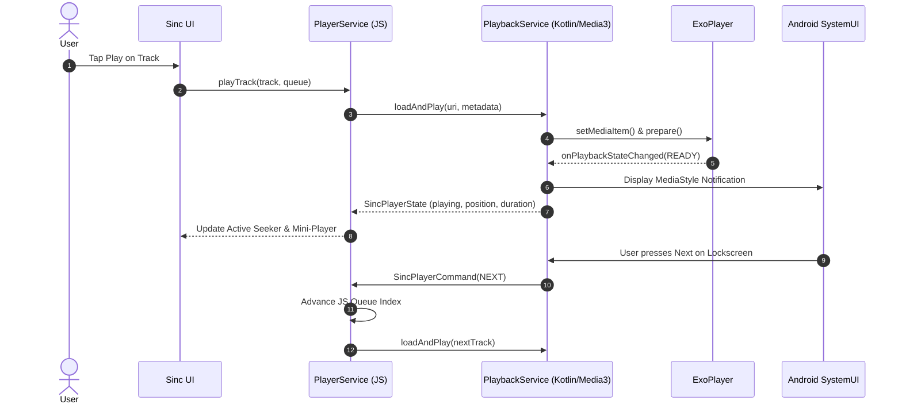

# Sinc Architecture & System Design

This document details the architectural principles, component topology, data flows, and technical decisions underpinning the Sinc music client and its ecosystem.

---

## 1. High-Level System Architecture

Sinc is engineered as a **local-first Android application** with a clean separation between UI presentation, state coordination, metadata resolution, on-device audio processing, and playback.

---

## 2. Core Architectural Pillars

### I. Local-First Philosophy

- **Zero Cloud Dependence**: Sinc does not require a hosted backend to search, stream, resolve metadata, or download music. All state persists directly on the user's device via high-performance MMKV storage.
- **Privacy by Design**: Listening events, taste vectors, and library entries never leave the device. No analytical beacons, telemetry pings, or opaque user tracking.
- **File System Sovereignty**: Downloaded audio is not siloed in a private encrypted sandbox. Audio files are exported directly into the public Android `Music/Sinc/` directory as standard `.m4a` or `.mp3` containers with full ID3v2.4 / MP4 metadata.

### II. Two-Tier Content Resolution

Streaming services conflate catalog metadata with binary audio delivery. Sinc decouples these into two distinct pipelines:

1. **Metadata Resolution Tier**: Sinc queries legitimate open and public catalogs (Deezer, MusicBrainz, LRCLIB) to assemble canonical metadata: track titles, album names, ISRC identifiers, release dates, track numbers, and uncompressed cover art.
2. **Audio Acquisition Tier**: When playback or download is requested, Sinc's resolver identifies candidate streams and executes strict verification against duration ($\pm 15$s maximum drift), track title tokens, and channel configuration to reject live bootlegs, nightcore edits, or slowed+reverb modifications.

---

## 3. Data Flow & Subsystems

### Audio Playback Pipeline

### Local Personalization & Taste Engine

Sinc incorporates a multi-factor recommendation engine running completely on-device without machine-learning bloat:

1. **Event Capture**: Playback sessions emit duration, completion fraction, and explicit interactions.
2. **Exponential Decay**:
   - Short-term affinity ($\tau = 5$ days) for immediate listening trends.
   - Long-term preference ($\tau = 30$ days) to capture enduring favorites.
3. **Safety Heuristics (Rule 13)**: Skips occurring within the first 30 seconds are weighted down ($w=0.15$) rather than treated as active dislikes, acknowledging accidental skips or context shifts.
4. **Maximal Marginal Relevance (MMR)**: Re-ranks candidate recommendation pools using a tunable diversity parameter ($\lambda = 0.70$) to prevent artist monopolization.
5. **Temperature Modes**:
   - _Familiar ($T = 0.2$)_: High-confidence favorite artists and repeat tracks.
   - _Balanced ($T = 0.7$)_: Default blend of 70% familiar and 30% discovery.
   - _Exploration ($T = 1.4$)_: Prioritizes genre neighbors and related artists.

---

## 4. Security & Cryptographic Boundaries

| Domain               | Mechanism                       | Implementation                                                         |
| -------------------- | ------------------------------- | ---------------------------------------------------------------------- |
| **App Lock**         | Biometric Prompt + PIN Fallback | `BiometricPrompt` with hardware-backed Keystore                        |
| **PIN Storage**      | PBKDF2 with SHA-256             | 10,000 iterations, 32-byte salt, stored in RN Keychain                 |
| **Local Database**   | Encrypted MMKV                  | Memory-mapped key-value store with hardware-backed encryption key      |
| **Network Security** | TLS 1.3 / Strict HTTPS          | Cleartext traffic disabled by default in `network_security_config.xml` |
| **API Privacy**      | Keyless Anonymous Access        | No user identity or bearer tokens transmitted to metadata providers    |

---

## 5. Technology Stack Summary

- **Framework**: React Native 0.75.5 (New Architecture enabled)
- **Language**: TypeScript 5.7 (strict mode)
- **State**: Zustand 5 + TanStack Query 5
- **Native Android**: Kotlin 1.9, AndroidX Media3 (ExoPlayer 1.4), Jetpack Lifecycle
- **Media Engine**: Custom Python 3.11 bionic bundle, yt-dlp, FFmpeg 6.0
- **Validation**: Zod 3.24
- **Testing**: Jest 29, Vitest (shared/server), React Native Testing Library
