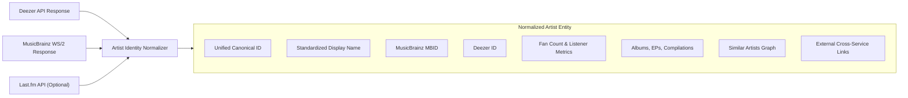

# Sinc Multi-Provider Metadata Architecture

Sinc decouples music discovery and metadata resolution from commercial streaming APIs. The application uses a unified, keyless multi-provider engine that queries open, legitimate public databases to construct a rich, accurate music graph without requiring paid subscriptions, proprietary SDKs, or developer API secrets.

---

## 1. Provider Roster & Responsibilities

| Provider                       | Purpose                                                                                 | Authentication                     | Rate Limit Strategy                              | Fallback / Redundancy                                        |
| ------------------------------ | --------------------------------------------------------------------------------------- | ---------------------------------- | ------------------------------------------------ | ------------------------------------------------------------ |
| **Deezer Public API**          | Primary catalog search, artist profiles, top tracks, releases, fan counts               | None (Keyless Public API)          | Token-bucket client throttle                     | Falls back to cached MMKV or MusicBrainz                     |
| **MusicBrainz WS/2**           | Canonical discography, MusicBrainz ID (MBID), artist relations, country/origin, aliases | None (Anonymous User-Agent)        | Strict 1 req/sec client-side limiter (`p-limit`) | Graceful degradation if throttled                            |
| **LRCLIB**                     | Synchronized (.lrc) and unsynchronized lyrics with millisecond timestamps               | None (Public Open-Source API)      | Asynchronous non-blocking fetch                  | Unsynchronized text or graceful absence                      |
| **Spotify (oEmbed & Scraper)** | Public playlist URL ingestion, playlist metadata, track extraction                      | None (Public oEmbed + HTML parser) | Best-effort HTTP with caching                    | Clear error reporting if playlist is private                 |
| **Last.fm** _(Optional)_       | Extended listener counts, global playcounts, community tags                             | Optional user-supplied API key     | Passive background query                         | Skipped if key is omitted; zero impact on core functionality |

---

## 2. Artist Identity Normalization Engine

Different music providers represent artists with varying spelling conventions, regional transliterations, and metadata IDs. Sinc routes all incoming provider responses through `artistIdentity.ts`:

### De-duplication and Matching Logic:

1. **Punctuation & Case Folding**: Normalizes casing, diacritics, and punctuation (e.g., `AC/DC` vs `AC-DC`).
2. **MBID Cross-Referencing**: When an MBID is returned by MusicBrainz, it serves as the immutable anchor across providers.
3. **Collaboration & Featured Artist Splitting**: Splits multi-artist strings (`feat.`, `ft.`, `&`, `,`) to map tracks to individual artist profiles.

---

## 3. Lyrics Synchronization & Linguistic Normalization

Lyrics are resolved via the open LRCLIB database using track title, artist name, and duration matching.

### Arabic & Multi-Lingual Script Support:

To ensure reliable lyrics retrieval for Arabic and Middle Eastern music, Sinc implements linguistic normalization:

- **Alef Normalization**: Folds `أ`, `إ`, `آ` to bare `ا`.
- **Yeh & Alef Maksura**: Folds `ى` to `ي`.
- **Teh Marbuta & Heh**: Normalizes `ة` to `ه`.
- **Diacritics (Tashkeel)**: Strips harakat (`َ ُ ِ ّ ْ ً ٌ ٍ`) before querying.

---

## 4. Spotify Playlist Import (Zero-Credential Pipeline)

Sinc allows users to paste public Spotify playlist links (`https://open.spotify.com/playlist/...`) directly:

1. **URL Parsing**: Validates and extracts the Spotify Playlist ID.
2. **Keyless Ingestion**: Queries Spotify's public oEmbed service and public web endpoints to resolve track names, artist names, and duration without requesting Spotify client IDs or secrets.
3. **Batch Audio Matching**: Ingests the resolved tracks into Sinc's download queue, matching each item against clean audio streams with strict fingerprint verification.
